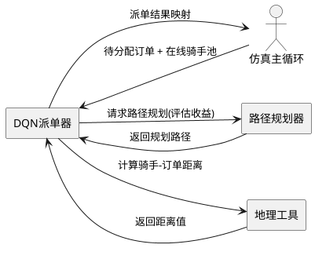
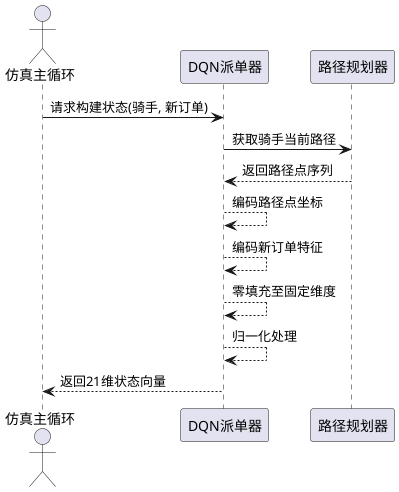
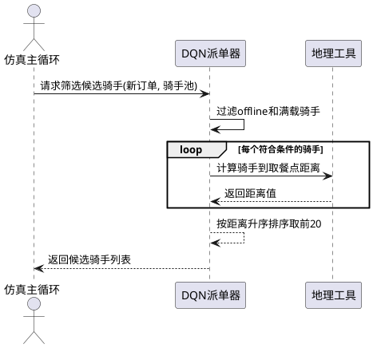
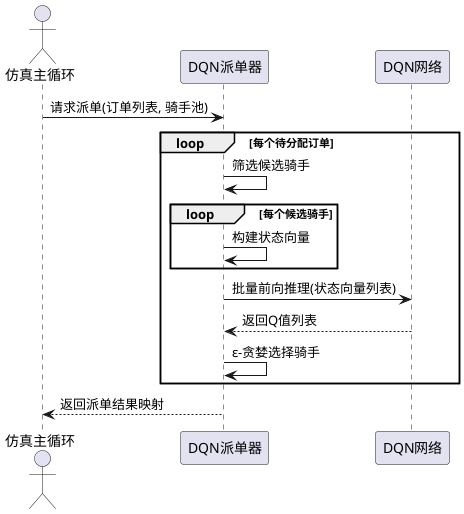
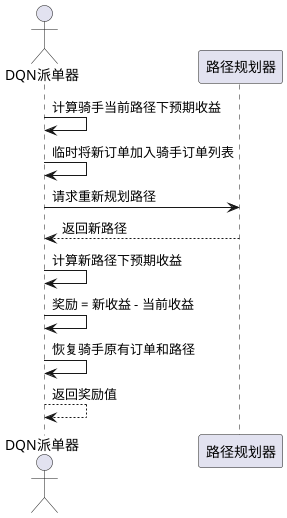
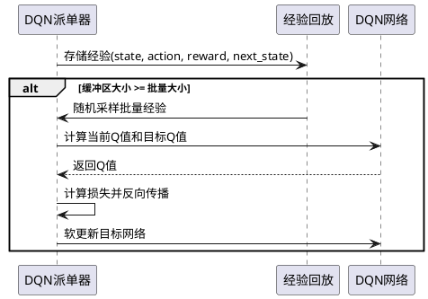
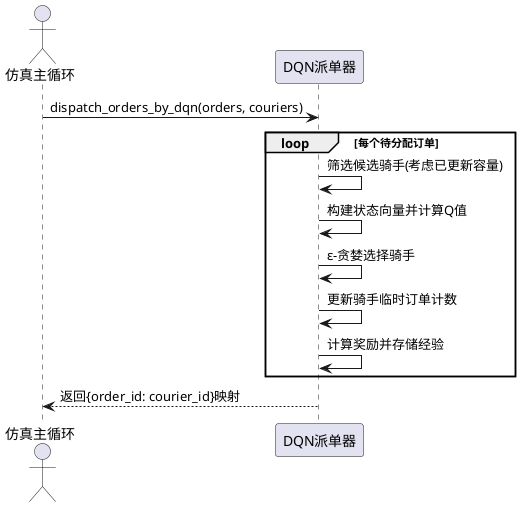

# **1. 组件定位**

## **1.1 核心职责**

本组件负责基于DQN强化学习算法进行订单-骑手智能匹配派单，实现相较于贪心策略更优的全局配送收益。

## **1.2 核心输入**

1. **待分配订单列表**：来自订单生成器的pending_orders，每个订单包含order_id、取餐点坐标、送餐点坐标、派单时间、预计备餐完成时间、预计送达时间
2. **在线骑手池**：来自骑手模拟器的couriers字典，每个骑手包含courier_id、当前位置、当前订单列表、已规划路径、特殊状态
3. **当前仿真时间**：仿真主循环的current_time
4. **路径规划器**：用于计算骑手接收新订单后的调整路径及预期收益

## **1.3 核心输出**

1. **派单结果映射**：{order_id: courier_id}，表示每个待分配订单分配给哪个骑手
2. **DQN训练经验**：(state, action, reward, next_state) 四元组，用于网络在线学习更新

## **1.4 职责边界**

1. 本组件不负责骑手上下线事件处理（由CourierSimulator负责）
2. 本组件不负责订单生成（由OrderGenerator负责）
3. 本组件不负责骑手状态移动刷新（由StateRefresher负责）
4. 本组件不负责路径规划的具体算法实现（由RoutePlanner负责），但需要调用RoutePlanner来评估收益
5. 本组件不负责仿真主循环的时间推进

# **2. 领域术语**

**DQN派单器**
: 基于Deep Q-Network强化学习算法的订单分派组件，通过神经网络近似Q值函数来选择最优订单-骑手匹配。

**状态向量**
: 描述骑手当前配送情境与新订单特征的数值向量，作为DQN网络的输入。

**Q值**
: 在给定状态下执行某个动作（将订单分配给某骑手）后，预期获得的累计折扣奖励的估计值。

**ε-贪婪策略**
: 以概率ε随机选择动作（探索），以概率1-ε选择Q值最大的动作（利用），用于平衡探索与利用。

**候选骑手集**
: 对每个待分配订单，按距离取餐点最近筛选出的前N名在线骑手集合。

**边际收益奖励**
: 骑手接收新订单后的预期总收益与接收前预期总收益的差值，作为DQN的即时奖励信号。

**路径点序列**
: 路径规划器为骑手规划的访问序列，每个点包含坐标、点类型（取餐/送餐）、对应订单ID。

**可用配送时长**
: 新订单的预计送达时间与当前仿真时间的差值，表示完成该订单的剩余时间窗口。

# **3. 角色与边界**

## **3.1 核心角色**

- 仿真主循环（DeliverySimulation）：调用DQN派单器执行订单分配，是本组件的唯一调用方

## **3.2 外部系统**

- RoutePlanner（路径规划器）：DQN派单器调用其plan_route方法来评估骑手接收新订单后的路径和收益
- StateRefresher（状态刷新器）：DQN派单器不直接调用，但依赖其刷新后的骑手状态作为输入
- geo_utils（地理工具）：DQN派单器调用haversine_distance计算骑手与订单之间的距离

## **3.3 交互上下文**

# **4. DFX约束**

## **4.1 性能**

1. 单次派单决策（单个订单的骑手选择）响应时间应当不超过100ms
2. 候选骑手集大小固定为20，避免计算量随骑手总数线性增长
3. DQN网络前向推理应当采用批量计算，对20个候选骑手同时计算Q值

## **4.2 可靠性**

1. 当DQN网络未训练或加载失败时，应当退化为基于距离的贪心派单策略
2. 派单结果必须保证每个订单恰好分配给一个骑手
3. 分配目标骑手必须处于online状态且当前订单数未达上限（4个）

## **4.3 安全性**

无特殊安全要求（仿真系统，非生产环境）。

## **4.4 可维护性**

1. DQN网络模型参数应当支持保存到文件和从文件加载
2. 训练过程中的损失值、奖励值应当记录日志
3. ε值衰减过程应当可配置

## **4.5 兼容性**

1. DQN派单器的接口应当与现有OrderDispatcherByDistance保持一致（输入orders+couriers，输出order_id→courier_id映射）
2. 应当支持在仿真主循环中通过配置切换分派器类型

# **5. 核心能力**

## **5.1 状态向量构建**

### **5.1.1 业务规则**

1. **骑手路径状态编码**：必须将骑手当前已规划路径的各路径点坐标按访问顺序编码进状态向量，每个路径点包含经度和纬度两个特征值
   - 验收条件：[骑手有2个pending订单和1个picked_up订单] → [状态向量前6个路径点坐标非零（2取+2送+1送），后续路径点坐标为零填充]

2. **新订单特征编码**：必须将新订单的取餐点经度、取餐点纬度、送餐点经度、送餐点纬度、可用配送时长编码进状态向量
   - 验收条件：[新订单可用配送时长为600秒] → [状态向量对应位置值为600]

3. **零填充规则**：当骑手现有路径点数量不足最大值时，剩余位置必须以0填充
   - 验收条件：[骑手无现有订单] → [状态向量前16个位置全为0]

4. **状态向量维度**：必须为21维，结构为[路径点1经度, 路径点1纬度, ..., 路径点8经度, 路径点8纬度, 新订单取餐经度, 新订单取餐纬度, 新订单送餐经度, 新订单送餐纬度, 可用配送时长]
   - 验收条件：[任意合法输入] → [输出向量长度为21]

5. **坐标归一化**：应当对经纬度坐标进行归一化处理，减去区域中心值后除以坐标范围
   - 验收条件：[输入原始经纬度] → [输出归一化后的值在[-1, 1]范围内]

6. **可用配送时长归一化**：应当对可用配送时长进行归一化，除以最大配送时长阈值
   - 验收条件：[可用配送时长为1800秒，最大阈值为3600秒] → [归一化值为0.5]

### **5.1.2 交互流程**

### **5.1.3 异常场景**

1. **骑手路径为空**
   - 触发条件：骑手当前无任何订单，路径规划器返回空路径
   - 系统行为：路径点部分全部零填充，仅保留新订单特征
   - 用户感知：无异常，正常输出21维向量

2. **新订单缺少预计送达时间**
   - 触发条件：新订单的estimate_arrived_time字段为NaT
   - 系统行为：可用配送时长设为默认最大阈值
   - 用户感知：无异常，使用默认值

## **5.2 候选骑手筛选**

### **5.2.1 业务规则**

1. **距离排序筛选**：必须计算所有在线且未达订单上限的骑手到新订单取餐点的Haversine距离，按距离升序排序取前20名
   - 验收条件：[有50名在线骑手，某订单取餐点已知] → [返回距离最近的20名骑手]

2. **骑手容量过滤**：必须排除当前订单数已达上限（4个）的骑手
   - 验收条件：[某骑手已有4个未完成订单] → [该骑手不出现在候选集中]

3. **在线状态过滤**：必须排除offline状态的骑手
   - 验收条件：[某骑手状态为offline] → [该骑手不出现在候选集中]

4. **候选集不足处理**：当符合条件的骑手不足20名时，必须返回所有符合条件的骑手
   - 验收条件：[仅有10名在线且未达上限的骑手] → [返回10名骑手]

### **5.2.2 交互流程**

### **5.2.3 异常场景**

1. **无可用骑手**
   - 触发条件：所有骑手均offline或已达订单上限
   - 系统行为：返回空候选集，该订单暂不分配
   - 用户感知：订单留在pending_orders中等待下一轮分配

## **5.3 Q值计算与动作选择**

### **5.3.1 业务规则**

1. **Q值批量计算**：必须对每个(订单, 候选骑手)对构建状态向量，通过DQN网络前向推理计算Q值
   - 验收条件：[1个订单+20个候选骑手] → [计算20个Q值]

2. **ε-贪婪动作选择**：必须以概率ε从候选骑手中均匀随机选择，以概率1-ε选择Q值最大的骑手
   - 验收条件：[ε=0.1, Q值最大骑手为A] → [约90%选择A，约10%随机选择]

3. **ε衰减规则**：每完成一次派单决策后，ε必须按衰减率递减，直至达到最小值
   - 验收条件：[ε=0.5, 衰减率0.995, 最小值0.01] → [经过约920次决策后ε降至0.01]

4. **禁止项**：禁止将订单分配给不在候选集中的骑手
   - 验收条件：[候选集为骑手A,B,C] → [分配结果必为A或B或C]

### **5.3.2 交互流程**

### **5.3.3 异常场景**

1. **DQN网络推理失败**
   - 触发条件：网络参数异常或输入维度不匹配
   - 系统行为：退化为距离贪心策略，选择候选集中距离最近的骑手
   - 用户感知：派单正常完成，但使用备用策略

2. **所有候选骑手Q值相同**
   - 触发条件：网络未充分训练，输出Q值完全一致
   - 系统行为：按ε-贪婪策略处理，选择第一个Q值最大的骑手
   - 用户感知：无异常，随机性由ε控制

## **5.4 奖励计算**

### **5.4.1 业务规则**

1. **当前收益计算**：必须根据骑手现有订单在当前路径规划下的配送情况，计算预期总收益
   - 验收条件：[骑手有2个订单，路径已规划] → [根据路径计算各订单配送收益并求和]

2. **调整后收益计算**：必须将新订单临时加入骑手当前订单列表，调用路径规划器重新规划路径，计算新路径下的预期总收益
   - 验收条件：[骑手原有2个订单+新订单1个] → [重新规划3订单路径，计算新总收益]

3. **边际奖励定义**：奖励必须等于调整后收益减去当前收益
   - 验收条件：[当前收益20，调整后收益23] → [奖励为3]

4. **订单收益计算规则**：单个订单的配送收益必须为基础收益(3元) + 配送距离(km)×1元/公里
   - 验收条件：[配送距离5km] → [订单收益=3+5=8元]

5. **超时惩罚规则**：若订单实际送达时间超过预计送达时间，必须按超时时长施加惩罚
   - 验收条件：[超时5分钟] → [扣减收益的10%]；[超时15分钟] → [扣减收益的40%]；[超时25分钟] → [扣减收益的50%]

6. **收益恢复**：计算完奖励后，必须恢复骑手原有的订单列表和路径规划，不得修改骑手的实际状态
   - 验收条件：[奖励计算完成] → [骑手的current_orders和route与计算前一致]

### **5.4.2 交互流程**

### **5.4.3 异常场景**

1. **路径规划失败**
   - 触发条件：临时加入新订单后路径规划器返回空路径
   - 系统行为：奖励设为负值（表示不应接受该订单）
   - 用户感知：DQN学习到该骑手不适合接此订单

2. **骑手无法在超时前送达**
   - 触发条件：新路径下某订单必然超时
   - 系统行为：收益计算中自动包含超时惩罚
   - 用户感知：奖励值较低，DQN倾向避免此类分配

## **5.5 DQN网络训练**

### **5.5.1 业务规则**

1. **经验回放**：必须将(state, action, reward, next_state)四元组存入经验回放缓冲区
   - 验收条件：[完成一次派单决策并获得奖励] → [经验存入缓冲区]

2. **批量采样训练**：当经验回放缓冲区大小超过批量大小阈值时，必须随机采样批量经验进行网络参数更新
   - 验收条件：[缓冲区有1000条经验，批量大小32] → [随机采样32条进行训练]

3. **目标网络软更新**：必须使用软更新方式更新目标网络参数，更新系数为tau
   - 验收条件：[tau=0.01] → [目标网络参数 = 0.99×原参数 + 0.01×主网络参数]

4. **训练触发条件**：必须在每次派单决策后尝试训练，而非等待整个仿真回合结束
   - 验收条件：[每步派单后] → [若缓冲区足够则执行一次训练]

### **5.5.2 交互流程**

### **5.5.3 异常场景**

1. **经验回放缓冲区不足**
   - 触发条件：缓冲区经验数小于批量大小
   - 系统行为：跳过本次训练，继续收集经验
   - 用户感知：网络参数不更新，等待更多经验

## **5.6 批量派单**

### **5.6.1 业务规则**

1. **逐订单派单**：必须对待分配订单列表中的每个订单依次执行候选筛选→Q值计算→动作选择的完整流程
   - 验收条件：[3个待分配订单] → [依次为每个订单选择骑手]

2. **骑手容量实时更新**：当一个订单被分配给某骑手后，必须立即更新该骑手的当前订单数，后续订单的候选筛选必须考虑此更新
   - 验收条件：[骑手A已有3个订单，被分配第4个订单后] → [后续订单筛选时骑手A被排除]

3. **派单结果一致性**：派单结果映射必须与实际分配操作一致
   - 验收条件：[派单结果显示订单O分配给骑手C] → [骑手C的current_orders中包含订单O]

### **5.6.2 交互流程**

### **5.6.3 异常场景**

1. **订单无法分配**
   - 触发条件：某订单的候选骑手集为空
   - 系统行为：该订单不分配，不出现在结果映射中
   - 用户感知：订单留在pending_orders中

# **6. 数据约束**

## **6.1 状态向量**

1. **维度**：必须为21维
2. **结构**：[路径点1经度, 路径点1纬度, 路径点2经度, 路径点2纬度, ..., 路径点8经度, 路径点8纬度, 新订单取餐经度, 新订单取餐纬度, 新订单送餐经度, 新订单送餐纬度, 可用配送时长]
3. **路径点数量**：最多8个路径点（4个订单×2点/订单），不足则零填充
4. **归一化范围**：经纬度归一化后应当在[-1, 1]范围内
5. **可用配送时长**：必须为非负数，单位为秒，归一化后除以最大配送时长阈值

## **6.2 DQN网络配置**

1. **输入维度**：必须为21（与状态向量维度一致）
2. **输出维度**：必须为1（输出单个Q值）
3. **隐藏层结构**：应当为2层全连接层
4. **候选骑手集大小**：必须为20
5. **骑手最大订单数**：必须为4

## **6.3 训练超参数**

1. **学习率**：应当可配置，默认值为1e-4
2. **折扣因子γ**：应当可配置，默认值为0.99
3. **经验回放缓冲区大小**：应当可配置，默认值为10000
4. **批量大小**：应当可配置，默认值为32
5. **目标网络软更新系数τ**：应当可配置，默认值为0.01
6. **ε初始值**：应当可配置，默认值为0.5
7. **ε衰减率**：应当可配置，默认值为0.995
8. **ε最小值**：应当可配置，默认值为0.01

## **6.4 奖励计算参数**

1. **基础收益**：必须为3元
2. **距离收益系数**：必须为1元/公里
3. **超时惩罚分级**：≤10分钟扣10%，≤20分钟扣40%，>20分钟扣50%
